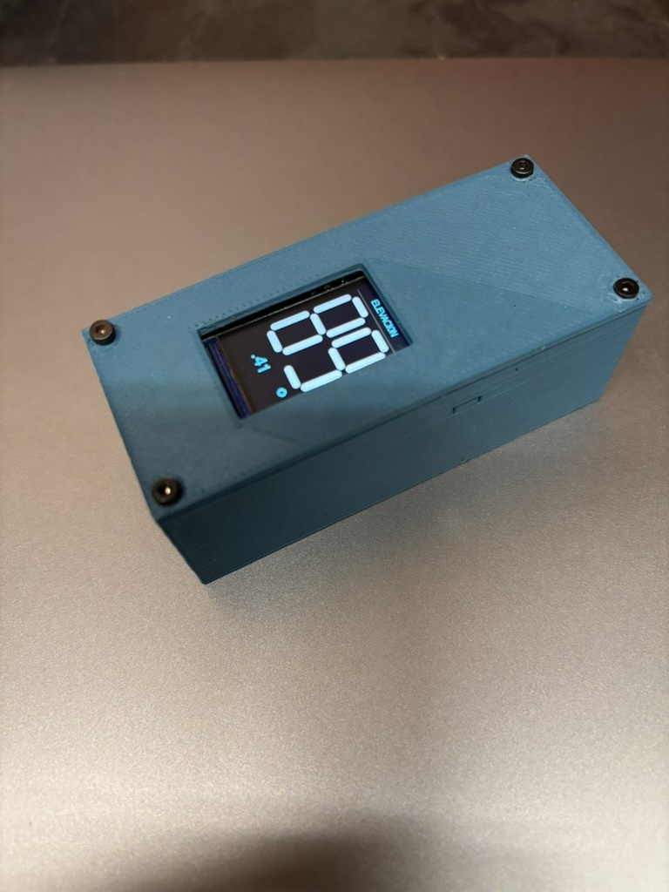

# Inclinómetro digital para helióstato — IER-UNAM

Instrumento experimental portátil para medir la **inclinación física del plano del espejo de un helióstato**, mediante una **TTGO T-Display ESP32** y un sensor inercial **BMI160** (acelerómetro y giroscopio). Desarrollado en el contexto de los trabajos sobre el **mini horno solar del Instituto de Energías Renovables de la UNAM**.

> **Estado:** prototipo operativo en evaluación; faltan pruebas de validación metrológica. Este repositorio contiene una **copia de referencia del firmware preparado en la conversación de desarrollo**, que debe cotejarse con el código efectivamente cargado y probado en la TTGO antes de reemplazar ningún archivo local.

Las [fotografías del dispositivo y su ensamblaje](hardware/fotografias/README.md) incluyen vistas del equipo terminado y de sus componentes internos. No sustituyen la verificación eléctrica de las conexiones.

## Convención angular

- **0°:** plano del espejo **vertical**.
- **90°:** plano del espejo **horizontal**.
- **Valores intermedios:** inclinación del plano respecto de la vertical.

No se trata de la altura del Sol calculada por un algoritmo astronómico; es la posición **física** de la superficie del espejo. El instrumento **no mide acimut**.

## Características implementadas

- Lectura I²C del BMI160 en la dirección `0x69`.
- Referencia de inclinación mediante el vector de gravedad, sin cero manual en cada encendido.
- Filtro complementario vectorial acelerómetro–giroscopio.
- Corrección del acelerómetro mediante calibración de **seis caras**.
- Corrección de **alineación geométrica** mediante referencia horizontal.
- Persistencia de parámetros en memoria no volátil (NVS) del ESP32.
- Visualización con números grandes en pantalla ST7789, en vertical, 135 × 240 píxeles.
- Comandos de calibración a través del monitor serie de PlatformIO.

Mostrar **dos decimales no implica exactitud de 0,01°**: la exactitud, repetibilidad y estabilidad están pendientes de validación.

## Hardware principal

| Elemento | Función |
| --- | --- |
| TTGO T-Display ESP32 (versión original) | Control y pantalla TFT |
| BMI160 (módulo inercial) | Medición de aceleración y velocidad angular |
| Batería LiPo de 3,7 V y 1000 mAh (etiqueta visible en fotografía) | Alimentación portátil |
| Interruptor entre RST/EN y GND | Mantiene la placa en reinicio; **no corta físicamente la batería** |
| Conector JST de 6 posiciones | Interconexión externa; pinout físico pendiente de verificar |
| Carcasa impresa en 3D | Soporte y protección; [STEP y STL disponibles](hardware/carcasa/README.md) |

La información de conexiones confirmada por el firmware y los datos por verificar se encuentran en [Hardware](documentacion/hardware.md).

## Compilación y carga

Requisitos: VS Code con PlatformIO, cable USB-C de datos y TTGO T-Display ESP32 original.

1. Abre **esta carpeta** con VS Code y PlatformIO.
2. Comprueba `platformio.ini` y, sobre todo, que `src/main.cpp` coincida con la versión que ya probaste físicamente.
3. Ejecuta **Build** y **Upload** con PlatformIO.
4. Abre el **monitor serie a 115200 baudios**.

Si la carga no inicia, la TTGO puede requerir entrar manualmente en modo BOOT. Consulta el [manual de uso](documentacion/manual-usuario.md).

## Calibración

La calibración del acelerómetro y la geométrica se realizan **una sola vez mientras no cambie el montaje**; sus parámetros se conservan tras reiniciar. El inclinómetro se puede encender en cualquier posición.

| Comando serie | Acción |
| --- | --- |
| `c` | Iniciar calibración de seis caras |
| `m` | Capturar una posición inmóvil |
| `h` | Registrar la referencia horizontal nivelada |
| `p` | Consultar parámetros guardados |
| `x` | Cancelar calibración en curso |
| `b` | Borrar las calibraciones |

**Orden recomendado:** seis caras (`c`/`m`), después referencia geométrica (`h`). Repetir las seis caras invalida la referencia geométrica previa. Lee antes [Calibración](documentacion/calibracion.md).

## Documentación

| Apartado | Documento |
| --- | --- |
| Contexto y objetivos | [Descripción](documentacion/descripcion.md) |
| Componentes y conexiones | [Hardware](documentacion/hardware.md) |
| Modelo de medición | [Fundamentos](documentacion/fundamentos.md) |
| Estructura de programa | [Firmware](documentacion/firmware.md) |
| Procedimientos de ajuste | [Calibración](documentacion/calibracion.md) |
| Ensayos pendientes | [Validación](documentacion/validacion.md) |
| Operación del instrumento | [Manual de usuario](documentacion/manual-usuario.md) |
| Decisiones históricas | [Historial de desarrollo](documentacion/historial-desarrollo.md) |

## Carcasa imprimible

Se incorporaron los [modelos STEP y STL de la caja, la tapa y el soporte](hardware/carcasa/README.md), además del ensamblaje STEP, **y los enlaces al diseño original en Onshape**. Los parámetros de impresión quedan a elección de cada persona; deben comprobarse el ajuste y las tolerancias del montaje.

## Material pendiente de incorporar

- Esquemático electrónico editable y contrastado con el ensamblaje real.
- Verificar que los [cuatro enlaces a los documentos originales de Onshape](hardware/carcasa/README.md) se puedan consultar con los permisos previstos (en particular, sin una sesión del autor).
- Fotografías del interruptor y del conector JST con el pin 1 identificable, y del montaje definitivo sobre el espejo.
- Mediciones de validación realizadas con referencia angular independiente.

Los directorios `hardware/`, `datos/` y `analisis/` incluyen instrucciones y plantillas; **no se presentan valores de ensayo inventados**.

## Revisión de ingeniería antes de usar el esquema

Las conexiones I²C están confirmadas por el código, y las fotografías documentan el prototipo. El interruptor **RST/EN–GND no equivale a un interruptor de batería**. El conector externo JST tiene **seis posiciones**, pero el orden físico y las funciones realmente cableadas deben confirmarse antes de representar un pinout definitivo. Consulta [hardware](documentacion/hardware.md).

## Derechos y publicación

Licencia y atribuciones institucionales **pendientes de definir** antes de publicar el contenido como abierto. Hasta elegir una licencia, el repositorio no concede automáticamente permisos de reutilización.

## Estado del código

Esta estructura se preparó para ordenar un desarrollo ya existente. **No se ha vuelto a compilar ni a ensayar físicamente esta copia del firmware dentro de este proceso de documentación.**
