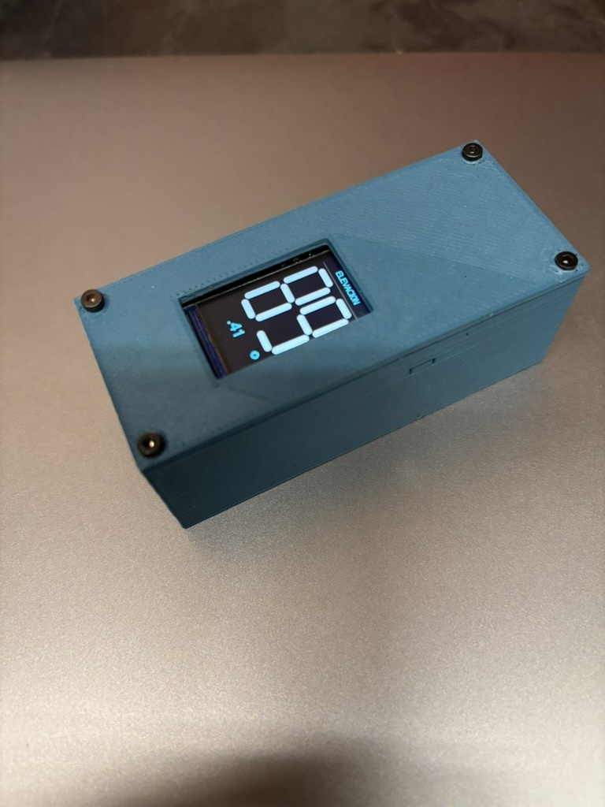
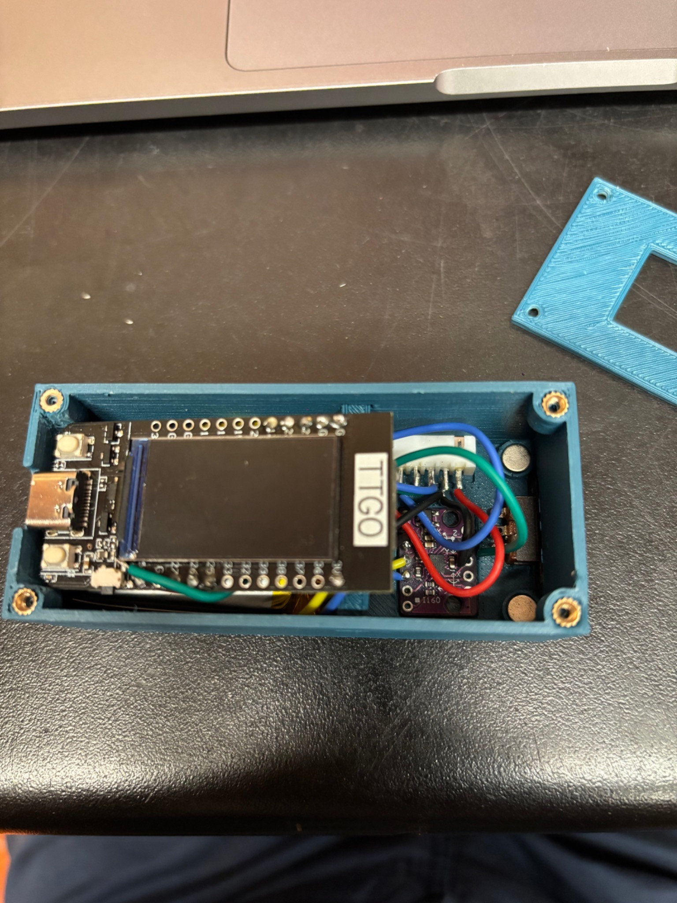
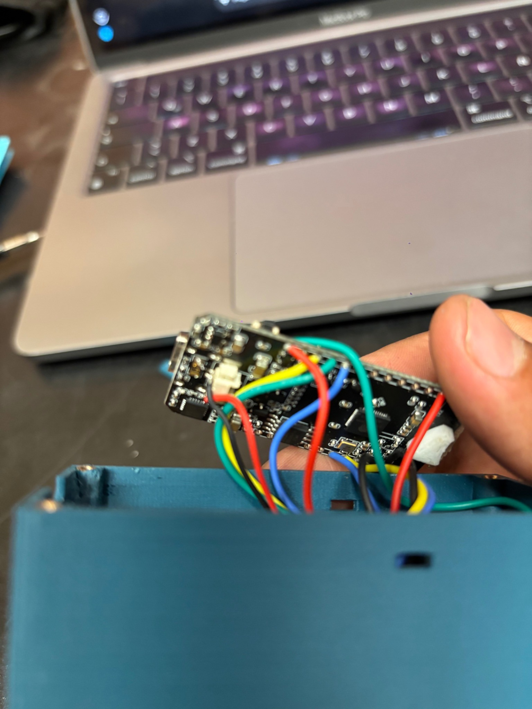
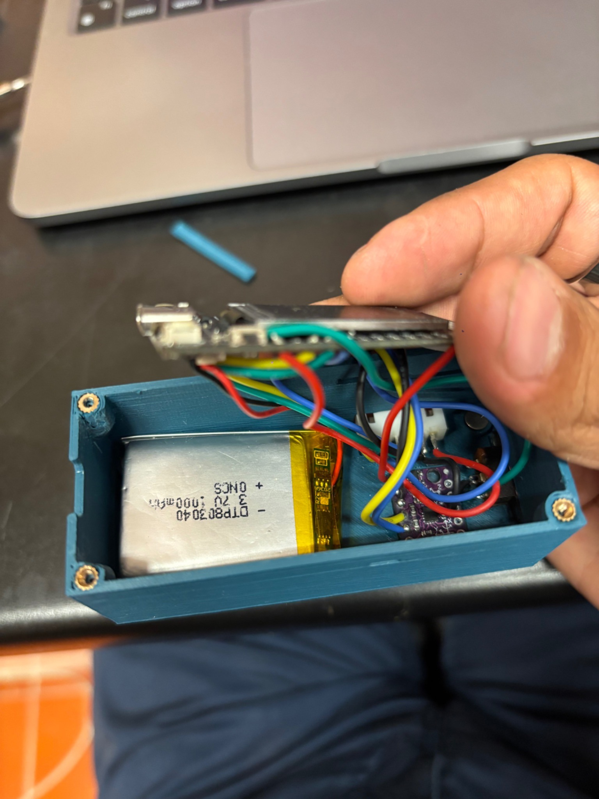

# Hardware y ensamblaje

## Componentes identificados

| Elemento | Identificación o característica | Evidencia / estado |
| --- | --- | --- |
| Placa principal | TTGO T-Display ESP32 original, TFT ST7789 135 × 240 | Firmware y fotografías |
| Sensor inercial | Módulo BMI160, dirección I²C `0x69` | Pruebas I²C y fotografías |
| Batería | LiPo **3,7 V, 1000 mAh** según etiqueta visible (DTP803040) | Fotografía del prototipo; capacidad nominal no ensayada |
| Interruptor | Un contacto entre **RST/EN y GND** | Confirmado por el montaje comunicado durante el desarrollo |
| Conector JST externo | **6 posiciones** | Confirmado en el desarrollo; serie y paso físico pendientes |
| Carcasa | Pieza impresa en 3D con insertos metálicos | Fotografías; STEP y STL de tres piezas incorporados |

## Conexiones utilizadas por el firmware

| TTGO | BMI160 | Propósito | Estado |
| --- | --- | --- | --- |
| GPIO21 | SDA | I²C datos | Confirmado por el firmware probado |
| GPIO22 | SCL | I²C reloj | Confirmado por el firmware probado |
| 3V3 | VCC / 3V3 | Alimentación del sensor | Verificar el pin rotulado del módulo |
| GND | GND | Referencia eléctrica | Configuración prevista; verificar montaje físico |

El módulo BMI160 debe alimentarse de acuerdo con las especificaciones de la **placa adaptadora**, no solo del circuito integrado desnudo. La pantalla está integrada a la TTGO y no requiere cableado externo adicional.

## Interruptor RST–GND

La conexión informada para el interruptor es **RST/EN → SW1 → GND**. Con el contacto cerrado, el ESP32 permanece en reset o deshabilitado según el circuito de la placa. **No es un interruptor de desconexión de batería**: pueden seguir consumiendo energía circuitos auxiliares, regulador y cargador. Debe etiquetarse en KiCad como *interruptor de habilitación/reinicio*, no como corte general de alimentación.

Si también hay un **pulsador RESET externo independiente**, su cableado y referencia física deben comprobarse antes de añadirlo al esquema final.

## Conector JST de seis posiciones

Durante la etapa de diseño se discutió una asignación *propuesta* de seis señales: alimentación, tierra, salida analógica de elevación, salida analógica de acimut, TX y RX. No se ha confirmado mediante continuidad el orden **real** de los terminales ni cuáles señales quedaron soldadas. Además, el firmware actual **no implementa DAC ni UART externos** y no mide acimut. Por tanto, no debe publicarse la tabla tentativa como pinout funcional.

Para el esquemático final, identificar físicamente el **pin 1**, la familia y el paso del conector, fotografiarlo, y comprobar continuidad hasta la TTGO. No conectar equipos externos hasta completar esa comprobación. Los GPIO del ESP32 son de 3,3 V; no aceptar señales externas de 5 V sin adaptación.

## Batería y carga

La fotografía interior permite leer la etiqueta **DTP803040 — 3,7 V — 1000 mAh**. La autonomía real y la ruta de carga del montaje no están caracterizadas. La batería de 1000 mAh sustituye el dato histórico de 250 mAh que se había manejado en notas preliminares.

El esquemático formal debe representar la batería y su conector de acuerdo con el cableado comprobado; no inferir polaridad únicamente por colores de cables.

## Montaje mecánico y calibración

La calibración geométrica registra la normal del sistema con la cara de referencia de la carcasa apoyada sobre una mesa nivelada. Para que esa calibración mida la elevación **del espejo**, la cara de apoyo debe quedar paralela al espejo cuando se usa el inclinómetro. Cualquier movimiento relativo entre sensor, carcasa e imanes de fijación invalida la referencia.

## Archivos CAD de la carcasa

El repositorio incluye [modelos de carcasa en STEP y STL](../hardware/carcasa/README.md): `Caja`, `Tapa` y `Soporte`, además del conjunto `Ensamblaje.step`. El modelo exportado de la caja mide aproximadamente **80 × 35 × 28 mm** y el conjunto **80 × 35 × 30 mm**. Son dimensiones del modelo CAD. Los [documentos originales de Onshape](../hardware/carcasa/README.md) se encuentran enlazados; quedan por verificar sus permisos de consulta y el ajuste físico. Los parámetros de impresión quedan a elección del fabricante.

## Registro fotográfico

La vista exterior documenta el equipo cerrado y armado. Las vistas interiores son evidencia de ensamblaje, **no** constituyen todavía un esquema verificable terminal por terminal.

## Entregables pendientes

- Esquemático editable en KiCad, validado contra continuidad eléctrica real.
- Biblioteca de símbolos/huellas de los módulos usados, con atribución adecuada.
- Identificación del tipo, paso y orden real del conector JST de seis posiciones.
- Confirmación de cómo quedan conectados la batería, el reinicio y la carga.
- Verificación de permisos de los enlaces al diseño fuente de Onshape, cuyos STEP y STL ya están incorporados.
- Fotografía del dispositivo instalado sobre la superficie de medición.
